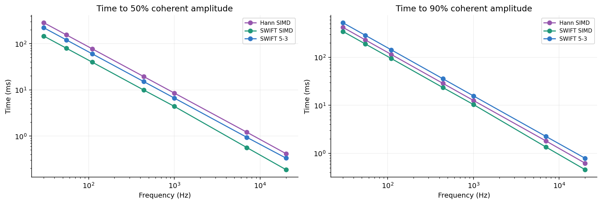
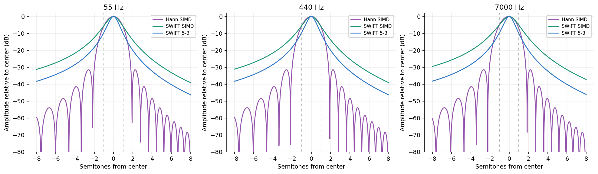
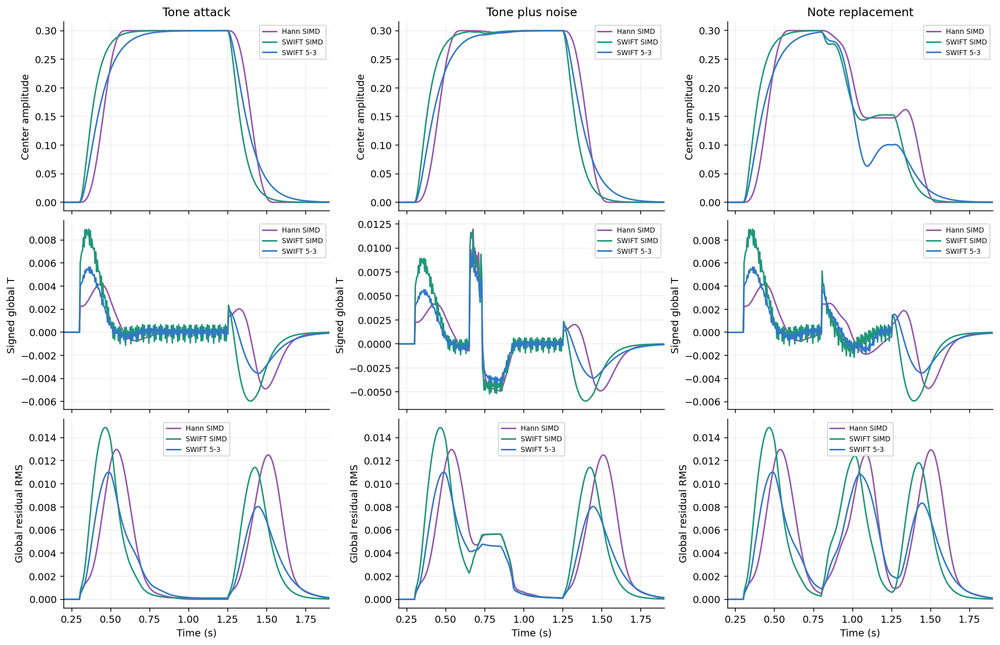
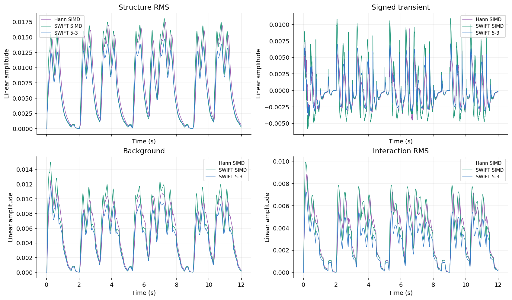
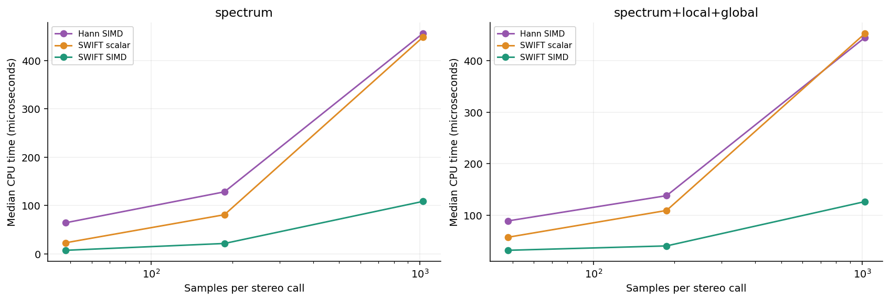

# SWIFT versus windowed SIMD DFT

> Historical measurements: the CSVs, plots and timings in this report used Hann-neighbor
> calibration with fast/slow ratio 0.6 and duration multiplier 1. They do not describe the
> current default. Production now uses full -3 dB bandwidth equal to geometric bin width
> (width scale 1), with two equal stages (imbalance 0). The study tool generates results
> for the new calibration when rerun; the recorded results below have not been regenerated.

## Current controls

SWIFT width is the full -3 dB bandwidth divided by geometric bin width. Its default is 1;
larger values are broader and faster, with more overlap. SWIFT imbalance defaults to 0
(two equal stages) and ranges to 1 (a single stage). Changing imbalance retunes the total
time constant S to preserve the requested width. Production solves the exact sampled
half-power response by bisection at construction time. No Hann reference is used for tuning.

## Historical controls used for these measurements

Open **Settings → Analyzer → DFT → Spectrum analysis**. **SWIFT** is the default on state;
**DFT** is the off state and uses the existing selected window. Switching follows the existing
session restart path, resetting analysis and its histories. For the recorded measurements, SWIFT used fast/slow ratio **0.6**
and duration multiplier **1**. Only the selected backend runs. Window controls are disabled in SWIFT;
SWIFT controls are disabled in DFT. The SIMD setting applies to either backend.

Duration 1 matches Hann's worst adjacent-note rejection for each bin, including Hann's rounded
length and center frequency. It always uses Hann as the reference, independently of the DFT
window currently selected. A lower multiplier responds sooner with more leakage. A higher one
narrows the response. Changing the ratio recalibrates the matched duration before applying the multiplier.

## Response and spectral quality

At 55 Hz and 48 kHz, the matched cascade uses about 3.30 / 1.98 carrier cycles rather than the
notebook's fixed 5 / 3. Both preserve unit coherent center gain. Here “attack” measures a complex
tone switched on at the requested center; it does not measure CPU latency or noisy note decisions.
Hann uses the actual existing periodic window and rounded center. Its tiny detuning means amplitude
attack and release need not be exact complements; their sampled crossing times coincide here.

| Backend | Slow / fast cycles | 10% attack | 50% attack | 90% attack / release to 10% | Noise bandwidth |
| --- | --- | --- | --- | --- | --- |
| Hann SIMD | finite Hann | 80.0 ms | 154.5 ms | 229.1 ms | 4.85 Hz |
| SWIFT SIMD | 3.30 / 1.98 | 24.9 ms | 79.5 ms | 188.6 ms | 5.21 Hz |
| SWIFT 5-3 | 5.00 / 3.00 | 37.7 ms | 120.4 ms | 285.6 ms | 3.44 Hz |

The matched cascade reaches half amplitude sooner and also reaches 90% sooner in this comparison.
Its infinite tail lasts longer than Hann's finite support. Matching one neighboring frequency does
not match the whole response: Hann has much stronger rejection at many more distant offsets and
exact nulls, while SWIFT has smooth leakage tails. The fixed 5/3 pair is more selective and slower.

The tuning sweep covers 44.1/48 kHz and 12/24 bins per octave over the default 30–8000 Hz domain.
The largest analytic matching error was **5.03e-12 dB**. The reference tests separately
compare the analytic Hann calculation with direct finite sums, including near-Nyquist/coarse grids.
Noise bandwidth is two-sided ENBW at coherent center gain. Equal tone gain does not imply equal
mean noise magnitude. `response.csv` also includes center gain, half-note detuning gain, and the
analytic real-tone minimum/maximum caused by the negative-frequency image.

## Downstream STBR behavior

Synthetic signals are analyzed at 48 kHz with the default 97-bin domain, the actual 1 kHz update
rate, a 0.2 s time window, a two-octave local frequency window, S time slope off, and T frequency
slope on. Input gain is unity for the comparison. Both local and global production fits consume
each backend's linear magnitudes. Trace CSVs keep every fifth observation; summary peaks use every row.
The centered tone is the first domain bin above 55 Hz (about 56.63 Hz), starting at 0.3 s.

| Backend | Global T peak after onset | Global R peak after onset | Peak R |
| --- | --- | --- | --- |
| Hann SIMD | 138 ms | 237 ms | 0.01297 |
| SWIFT SIMD | 52 ms | 165 ms | 0.01486 |
| SWIFT 5-3 | 52 ms | 187 ms | 0.01100 |

The matched backend makes T respond earlier, but its clean-tone onset also produces a different,
larger peak residual. This is evidence of changed time/frequency interaction, not proof of more
physical noise. Residual RMS remains the existing patch statistic. No STBR weights or component
gains were changed to make either backend appear better. Unequal-neighbor fixtures include a
20 dB amplitude difference; matching leakage does not guarantee recovery of the quieter note.

The music example uses the first 12 seconds of `TestFiles/test_input.wav`
(44100 Hz, 2 channels), without input gain. It has no labeled
STBR ground truth; these traces demonstrate behavioral differences rather than objective component accuracy.

## CPU performance

Numbers below are **median / p95 microseconds per stereo call**, measured in Release on the machine
in [benchmark-machine.txt](benchmark-machine.txt). The benchmark thread is pinned to logical CPU 0;
tiered compilation is disabled. Each case warms for at least 200 ms and enough samples to populate
the Hann and STBR histories. Five measured rounds target approximately 200 ms each. Every timed
call includes linear magnitude readout. The combined workload additionally includes both local fits
and the shared global fit at the actual block update rate. Audio synthesis, construction, and I/O are excluded.

| Block | Workload | Hann SIMD | SWIFT scalar | SWIFT SIMD | Median speedup vs Hann |
| --- | --- | --- | --- | --- | --- |
| 48 | spectrum | 64.60 / 73.00 | 23.20 / 26.00 | 7.60 / 8.10 | 8.50× |
| 48 | spectrum+local+global | 89.20 / 114.10 | 57.50 / 66.00 | 32.20 / 40.20 | 2.77× |
| 187 | spectrum | 128.50 / 178.50 | 81.20 / 97.30 | 21.70 / 23.60 | 5.92× |
| 187 | spectrum+local+global | 138.20 / 184.00 | 109.50 / 146.00 | 40.70 / 48.10 | 3.40× |
| 1024 | spectrum | 456.10 / 591.30 | 448.30 / 530.90 | 108.70 / 138.30 | 4.20× |
| 1024 | spectrum+local+global | 445.20 / 595.30 | 452.90 / 561.40 | 126.70 / 162.80 | 3.51× |

The full CSV additionally covers 44.1 kHz and 24 bins/octave. The largest measured processing
allocation was **0 bytes per call**. Construction allocations include transient tuning objects,
so `construction_bytes_stereo` is not retained memory. In the default stereo 48 kHz/97-bin setup,
construction allocated 7,841,192 bytes for Hann and
41,464 bytes for SIMD SWIFT. SWIFT retains no audio sample
history; its array payload is approximately 31,760 bytes for this domain, excluding
array/object headers. STBR retains its existing separate histories in either case.

These are CPU timings, not audio-to-display measurements. Maximum timings include OS scheduling
outliers and are preserved in the raw CSV. No rendering performance claim is made; the low-resolution
GPU tests are correctness tests. Any future rendering timing must use at least 1280×720.

## Silence, checks, and limits

SWIFT decays naturally after zero input and clears each bin after 48 slow time constants plus two
samples of exact zeros. This truncates a negligible tail without gating quiet nonzero audio. A new
nonzero input restarts the silence clock, including within a bulk call. Discontinuities reset state.

Checks cover independent weighted sums; scalar/SIMD/chunk parity; equal and nearly equal poles;
direct Hann calibration; real-tone gain and image; quiet input; allocation; backend routing; analyzer
channel wiring; and active-input-to-silence GPU rendering. The existing finite-window implementation
and its direct-reference regressions remain available. Recorded validation:

- Non-GPU regression suite: 201 passed, 0 failed.
- Real SWIFT/STBR GPU silence: 6 passed, 0 failed.
- Existing all-scene GPU silence: 50 passed, 0 failed.

The implementation's WinUI application build completed in Release/x64 with zero warnings or errors.
Re-running the study alone does not rebuild WinUI or rerun regressions.

This is a bank of note-centered amplitude measurements. It adds no discrete note events or
polyphonic inference, and it does not fuse the nonlinear magnitude operation with the STBR fit.

## Reproduction and raw data

See [the study README](../../tools/AEther.SwiftStudy/README.md) for commands.
Raw results: [response](response.csv), [transfer curves](transfer.csv), [tuning](tuning.csv),
[scenario summaries](scenarios.csv), [STBR traces](traces.csv), and [CPU performance](performance.csv).
